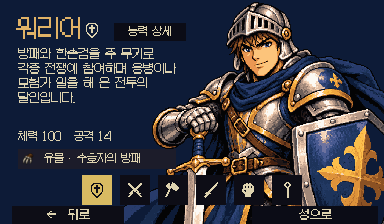
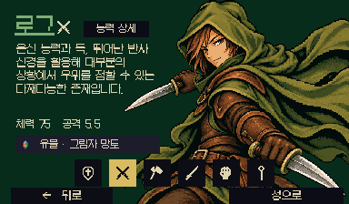
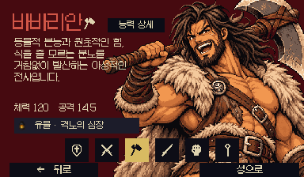
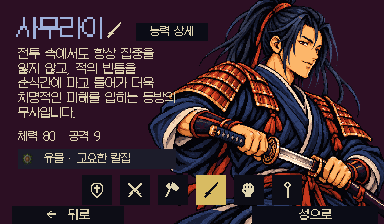
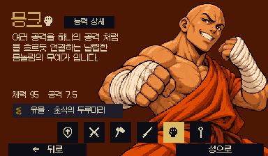
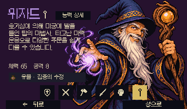
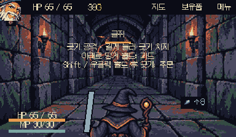
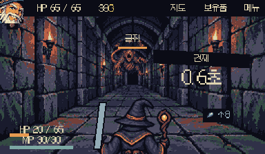

# 리소스 정리 · 2026-10-24

현재 빌드의 두 씬, Resources 로딩, 프로젝트 설정과 코드 경로를 기준으로 참조를 추적했다. Unity의 실제 의존성 조회와 파일의 GUID 그래프를 대조한 뒤 제거했다.

- [x] 미사용 데이터 84개 제거: 구 특전·플레이어·방 데이터, 비활성 Forge 스테이지와 소속 전투·몬스터·공격·포즈, 미연결 조우.
- [x] 미사용 아트 62개, 완료된 마이그레이션/백업 파일 32개, 기타 구 프리팹·샘플·튜토리얼·스크립트 9개 제거.
- [x] 합계 187개 파일과 대응 메타데이터 제거. 원본 파일 약 89.64 MiB 감소. 폴더 메타데이터는 이 수에 포함하지 않는다.
- [x] 기존 파일 681개 이동. 모든 파일 GUID 보존. 이동한 현역 데이터 458개는 원본과 바이트 단위로 동일하다.
- [x] 옛 `Behemoth`, `DungeonSlashPrototype`, `Arcade224`, `AshenVow` 생산 폴더를 용도별 구조로 통합.
- [x] 과거 자동 생성/초기화 레시피와 아트 롤백 참조 제거. 현재 씬과 데이터는 저장된 자산으로 바로 사용한다.
- [x] 한국어 텍스트 키 유지. 삭제된 자산 소유의 항목 112개만 제거하고 남은 CSV 1,828개 원문은 개행까지 보존. 소스 경로만 이동 위치로 갱신했다.

## 현재 구조

```text
Assets/
  Art/
    Characters/{Combat,Companions,Portraits,Selection}
    Enemies/{Combat,Portraits}
    Environments, Fonts, Materials, Shaders, TextMeshPro, UI
  Data/
    GameContent.asset
    Characters/Companions
    Combat/{Attacks,Buffs,BuffTags,Monsters}
    Dungeon/{Encounters,Events,Stages}
    Items/{Relics,Potions,Spells,Perks,PerkAbilities,PerkOfferGroups,Supplies}
    Localization, Presentation, Rendering, Resources, Settings
  Editor/{Inspectors,Localization,Presentation,Verification}
  Prefabs/{Combat,Companions,UI}
  Scenes/{OutGameScene,MainGameScene}.unity
  Scripts/{Combat,Data,Debug,Dungeon,Presentation,Rooms,Run,UI}
  Plugins, Tests
```

기존 네임스페이스와 게임플레이 어셈블리 이름은 유지했다. Scripts 루트로 옮긴 asmdef에는 기존 렌더링 스크립트가 사용하는 URP/Core 런타임 참조를 추가했다. 테스트와 로컬 검증 도구의 자산 경로도 갱신했고, 기존 몬스터 검증의 대상은 디자이너가 조정한 17개 원본으로 유지했다.

삭제·이동별 원래 위치, 새 위치와 GUID는 [AssetChanges.csv](AssetChanges.csv)에 있다. 라이선스, 외부 편집용 한국어 CSV, TMP의 셰이더/include 배포 파일은 유지했다. 셰이더 이름·include로 사용하는 라이브러리는 씬의 GUID 참조만으로 삭제하지 않았다. Plugins는 수정하지 않았다.

## 검증 기록

Unity 6000.0.59f2의 기존 편집기에서 수행했다. 추가 Unity 인스턴스나 전체 테스트·밸런스 비교는 실행하지 않았다.

| 항목 | 결과 |
| --- | --- |
| 런타임·에디터·테스트 어셈블리 재컴파일 | 통과 |
| 프로젝트 재시작 후 재컴파일 | 이전 asmdef 경로의 편집기 메모리 캐시 중복 해소. 일회성 검사/복구 코드는 제거 |
| 두 빌드 씬 열기, Missing Script 및 직렬화 참조 검사 | 새 누락 0건 |
| 모든 현역 데이터 로딩과 참조 검사 | 통과: 직업 6, 스테이지 3, 장비 103, 특전 41, 주문 16, 이벤트 23 |
| 기존 파일 이동 후 GUID 대조 | 전부 일치 |
| 이동한 현역 데이터 내용 대조 | 458개 전부 동일 |
| 소스의 고정 자산 경로 존재 검사 | 누락 없음 |
| 타이틀 → 6직업 선택 | 아트·재질·아이콘·한글 표시 확인; 아래 캡처 |
| 위자드 선택 → 탐험 시작 → 오른쪽 방 이동 | MainGameScene, B1 배경·HUD·캐릭터·굴쥐 조우 표시 확인 |
| 전투 진행 | 몬스터 공격 준비/타격 표시, 체력 감소, 포즈 표시 확인 |
| 런타임 오류 로그 | 위 실행 확인 중 추가 오류 없음 |
| Git 공백 검사 | 통과 |

전투 입력 코드는 수정하지 않았다. OS 마우스 드래그 시도는 행동 완료로 기록되지 않아 스와이프 조작감은 검증 완료로 취급하지 않는다. 실제 기기, 멀티터치, 전체 이벤트 진행 및 DPS/밸런스 회귀 검증은 이번 정리의 실행 범위에 포함하지 않았다.

URP의 `PC_Renderer`에는 정리 전부터 패키지의 Probe Volume 디버그 리소스 누락 7건이 있었다. 렌더러 파일이 원본과 바이트 단위로 동일함을 확인했고, 새 누락과 구분해 [ReferenceVerification.txt](ReferenceVerification.txt)에 기록했다. 이 외부 패키지 문제는 이번 변경에서 수정하지 않았다.

| 직업 | 캡처 |
| --- | --- |
| 워리어 |  |
| 로그 |  |
| 바바리안 |  |
| 사무라이 |  |
| 몽크 |  |
| 위자드 |  |



