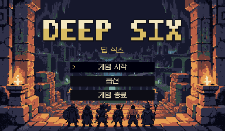
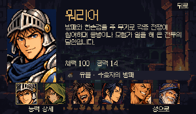
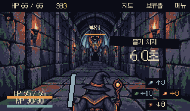
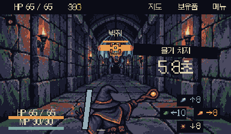

# 직접 피드백 반영 · 2026-10-24

이번 요청의 구현과 기존 Unity Editor에서의 해당 동작 검수를 마쳤다. 전체 밸런스/DPS 스위트와 별도 Unity 인스턴스는 실행하지 않았다.

## 적용 화면

## 확인 결과

| 항목 | 결과 / 근거 |
| --- | --- |
| 기존 Description | 여섯 캐릭터 모두 `PlayerCombatData.description` 원문과 표시 문자열 일치. 넘침 없음. 임의의 selectionStory는 표시하지 않음. |
| 선택 화면 | 여섯 얼굴이 한 화면에 표시. 버튼42×42, 얼굴40×40.320×320 소스를8:1로 표시. 큰 그림은384×576 소스를96×144로4:1 표시. 비율 변형 없음. |
| 유물 팝업 | 기존 재사용 HoverTooltipTrigger/ItemTooltipView 유지. 실제 시작 유물 설명을 사이드 팝업에 표시. `Selection-RelicPopup.png`. |
| 타이틀 | DEEP SIX · 딥 식스. 여섯 용사가 마왕의 지하미궁으로 들어가는 배경. 중앙 픽셀 워드마크와 시작/옵션/종료. 타이틀 최종 캡처18색. |
| 픽셀 표시 |384×224 native 출력, Point, 무압축/밉맵 없음. 로고는 정수 픽셀 도형. 포트레이트 원본 색 유지, 타이틀 배경에만17색 UI 팔레트 적용. |
| 중앙 안내 | 정수11px 폰트와3줄 안내. 첫 행동/가드 후 숨김. 몬스터별 긴 설명이 중앙에서 겹치던 표시는 compact HUD에서 숨김. |
| 가드 게이지 | PDF20p 기준 청회색(147,171,182), 기울어진12×70 native 윤곽, 기울기8px/테두리2px, 캐릭터 왼쪽. 최종 전투 PNG에 해당 RGB738픽셀 확인. |
| MP | 주문이 없는 Warrior도 전투 시작 시 표시. HP 아래92px 폭. |
| 전투 상태 | PDF18p 기준 캐릭터 머리 위 중앙. 몽크 초식명/화살표 준비 상태 확인. |
| 몬스터 체력바 |42×3 native로 복원. 몬스터 아트 확대와 기존 판정 반경 유지. 패턴명/카운트다운 분리. |
| 약점 | 누락된 CanvasRenderer 복원, 앞쪽 레이어와 고대비 모서리. 실제 차지 중 표시·판정 확인.3개 필요 타격 표시가 한 번 타격 후2개로 감소. |
| 사무라이 | 일반/수동 차지 납도 공격은 `발도!`, 패리 준비 상태의 공격만 `패리 발도`. 실제 가드 후0.24초 패리,0.36초 일반 가드 확인. 기본 창0.3초. |
| 주문 슬롯/메뉴 | 우하단 십자 배치. 두 자리 MP도 한 줄. 메뉴는 우상단 가장 오른쪽, 지도/보유품은 그 왼쪽. |
| 가드 입력 | 단순 누름/홀드로 가드하지 않음. 캐릭터에서 아래로 당기고 홀드하면 가드. 두 포인터 겹침/들기/다시 누르기3회 연속 검사. 마지막 포인터를 떼면 해제. 다른 방향의 무기 긋기도 허용. |
| 우클릭 주문 | 홀드 시간 축적, 가드와 독립, 방향 긋기 발동, 놓으면 캐스팅 초기화. 이른 발동은 MP를 사용하지 않음. |
| Shift 주문 | Shift 홀드만으로 캐스팅 축적, 좌클릭 긋기 발동, Shift 해제 초기화. 검수에서는 Shift 상태를 Editor 전용 주입으로 공급하고 실제 프레임의 타이머/생산 입력 핸들러를 사용. |
| 조준 | 볼트는 긋기 시작점과 방향으로 관통. 벼락은 긋기를 끝낸 지점으로 낙하. 각각 적중과 빗나감 확인. 빗나가도 시전한 MP는 소비. 자동 대상 유틸 주문은 기존 동작 유지. |
| 아트 롤백 |355개 참조의 geometry/arcade 왕복과 게임플레이 데이터 지문 일치. 새 배경 재질도 geometry 모드에서는 제거. 시스템/이벤트/퍽/주문 데이터 보존. |

생산 입력 및 전투 검수의 고유42개 체크가 통과했다. 로그: `Logs/OctoberReview-Live.txt`. 선택 확인: `Logs/OctoberReview-Selection.txt`. 반복 작업 중 최초 Shift 검사의 실패는 `Iteration-Checks.txt`에 보존했으며, 이후 컴파일을 마치고 Play를 다시 시작한 반복 검사에서는0.65초 축적/발동/해제 모두 통과했다. `Logs/AshenVow-Errors.txt`에는 이 과거 검사 실패와 이전 작업의 오류 이력이 남아 있다.

입력 검수는 기존 Editor의 실제 프레임에서 포인터 접점/Shift 상태를 주입한 방식이다. 데스크톱 UI에서는 시작/캐릭터 선택/실제 게임 진입을 직접 조작했다. 자동 UI 도구는 키/우클릭을 길게 누른 채 유지하는 API가 없어 실제 OS 키 홀드와 실물 모바일 멀티터치는 미검수다. broad balance/장기 런/실기기 가독성은 이번 범위에서 실행하지 않았다.

기존 Warrior/B1/B2/B3 수치와 디자이너 편집은 보존했다. 연습 적의 큰 HP/긴 대기/3회 약점은 런타임 복제 데이터에서만 설정하며 저장하지 않는다. player3 / monster4 / dog2 대표 이미지 전환도 유지한다. 예약 자동화는 재활성화하지 않았다.
