# 사용 컷 분리 · 2026-10-25

미사용 컷이 남아 있던 생산용 스프라이트 시트 40개를 제거하고, 실제 참조되는 313개 컷을 독립 PNG로 연결했다. Computer Use, 창 활성화, 키보드·마우스 자동화는 사용하지 않았다.

- [x] 캐릭터·몬스터·동료 포즈, 초상화·피로도 표정, 아이템·주문 아이콘, 이벤트 그림을 개별 이미지로 분리.
- [x] 원본 시트와 대응 메타데이터 40쌍 제거. PNG 원본 합계 75.79 MiB → 38.09 MiB. Git 이력과 이번 작업의 임시 복구 ZIP은 이 수에 포함하지 않는다.
- [x] 326개 파일의 Sprite 참조 558개 교체. 분리 후 참조되지 않는 PNG 0개, 제거한 시트 GUID를 가리키는 자산 0개.
- [x] 113개 컷의 기존 경계 밖에 있던 보이는 픽셀을 포함. 사무라이 공격은 칼끝 등 1,314픽셀을 추가로 보존했다.
- [x] 기존 수정 중이던 씬·프리팹·데이터의 다른 필드는 보존. Sprite 참조 교체와 `canvasScale` 추가만 역변환하면 해당 326개 파일이 작업 직전 내용과 바이트 단위로 동일하다.
- [x] 한국어 텍스트·CSV, 수치·효과·캐릭터/몬스터 밸런스는 변경하지 않음.
- [ ] 실제 Unity 임포트 및 Play 모드에서의 표시 검증은 보류. 아래 제한 참고.

## 배치

```text
Art/Characters/Combat/Samurai/{Idle,Attack,Guard}.png
Art/Characters/Companions/TrailDog/{Idle,Attack,Portrait}.png
Art/Characters/Portraits/Warrior/{Portrait,Thumbnail,Rear,Fatigue0..3}.png
Art/Enemies/Combat/MirrorKnight/{Idle,Ready,Attack,Dead}.png
Art/Enemies/Portraits/{MazeGuardian,Minotaur,Bat,...}.png
Art/UI/Icons/Items/{Shield,HealingPotion,Firebolt,...}.png
Art/UI/Events/{MagicTeacher,StrayDog}.png
```

각 PNG는 Single Sprite, Full Rect, Point 필터, 밉맵 없음으로 설정했다. 원본 픽셀은 재생성하거나 확대 보간하지 않았다. 임포트 최대 크기는 기존 시트의 실제 해상도 예산을 컷별로 나눠 32~1024로 설정했다. 시트를 개별 파일로 나눴다는 이유만으로 모두 2048 텍스처가 되지 않도록 했다.

이미 하나의 그림인 타이틀 로고와 TMP가 텍스처 좌표로 사용하는 외부 Emoji 폰트 아틀라스는 이 분리 대상에 포함하지 않았다.

## 잘림 방지

기존 메타데이터의 균등 격자는 실제 그림의 행 간격과 맞지 않는 경우가 있었다. 사무라이 칼끝뿐 아니라 거울기사·종지기·죽음 포즈 등도 원래 사각형 밖에 그림이 이어져 있었다.

단순히 사각형을 잘라 저장하지 않고, 불투명 중심부의 연결과 실제 행 순서로 포즈의 소속을 판별했다. 다른 컷들을 이어 붙이는 옅은 투명 잔상은 소속 판별에서 제외하고, 가장 가까운 그림에 원본의 반투명 픽셀을 돌려놓았다. 보이는 픽셀의 경계에 여백을 두었으며, 6% 미만 알파의 희미한 잔여물만 안전 여백에서 정리했다. 원래 초상화·썸네일처럼 의도된 화면 구도는 그대로 보존했다.

전투용 데이터 49개에는 포즈 공통의 `canvasScale`을 저장했다. `CombatSpriteAnimator`가 UI 메시의 그리기만 보정한다. `RectTransform`, 배치, 가드·피격 영역은 변경하지 않는다. 동료도 같은 그리기 처리를 사용한다. 여백이 넓어진 공격 컷만 작아지거나 포즈마다 중심이 이동하는 현상을 피하기 위한 변경이다.

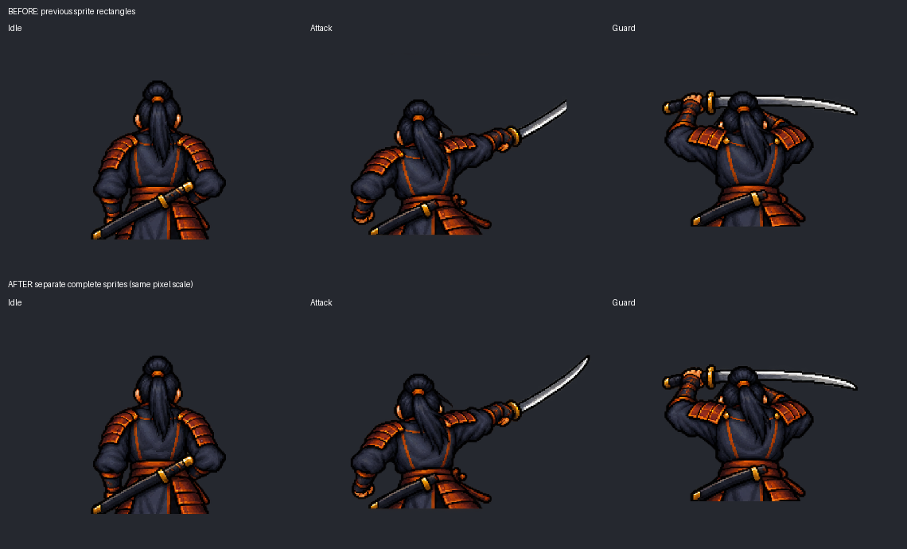

## 검증

| 항목 | 결과 |
| --- | --- |
| 분리된 313개 이미지의 보이는 RGBA와 원본 대조 | 일치 |
| 254개 포즈·아이콘·이벤트 이미지의 투명 가장자리 | 통과 |
| 59개 의도된 초상화/썸네일 구도 | 원본 사각형 유지 |
| 추출한 보이는 픽셀 수 보존 | 통과 |
| 전체 313컷 육안 검토 | 아래 10개 검수 시트 확인 |
| 사용되지 않는 새 PNG / 과거 시트 참조 | 각각 0개 |
| 기존 씬·프리팹·데이터 수정 보존 | 326개 파일 역변환 대조 통과 |
| C# 컴파일 | Unity 6.0.59f2의 Roslyn과 현재 프로젝트 응답 파일·참조 DLL로 런타임 및 최종 에디터 코드 독립 컴파일 통과 |
| 실제 Unity 임포트·Play | **미실행** |

열린 Unity는 파일 요청으로 상태 조회와 Play 종료가 가능했으나, 외부 스크립트·이미지 변경을 자동으로 가져오지 않았다. 새 검증 코드를 불러올 수 없어서 임포트 및 실제 UI 메시 렌더 검증을 완료하지 못했다. Computer Use 제한을 지키고 추가 Unity 인스턴스도 실행하지 않았다. 이 결과를 실행 검증 완료로 취급하지 않는다.

준비했던 좁은 검증 범위는 새 Single Sprite 313개 임포트 확인과 전투 상태 188개의 `Image + CombatSpriteAnimator` 렌더 확인이다. [RuntimeMatrix.txt](RuntimeMatrix.txt)에 보류 상태를 기록했고, [UnitySpriteVerification.cs](UnitySpriteVerification.cs)는 참고 소스로만 이 폴더에 보관했다. Assets에 일회성 검증 코드를 남기거나 지연 실행 요청을 예약하지 않았다. 물리·입력·밸런스 전체 테스트는 실행하지 않았다.

개별 경로·기존 Sprite ID·추출 범위·임포트 크기는 [Manifest.json](Manifest.json), 사람이 보기 쉬운 목록은 [Sprites.csv](Sprites.csv), 정적 검사 결과는 [StaticVerification.txt](StaticVerification.txt)에 있다.

## 검수 시트

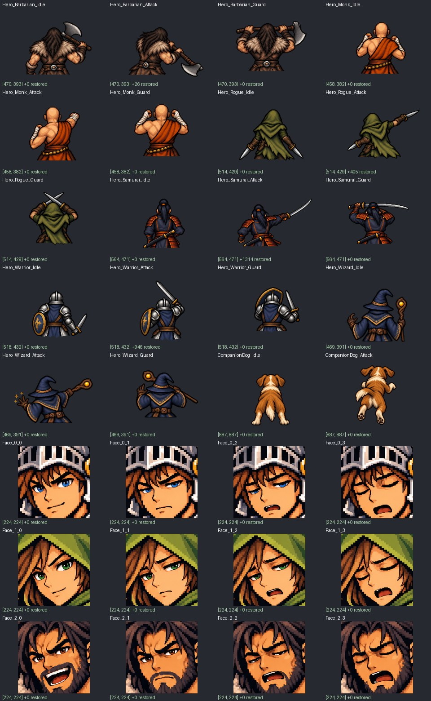
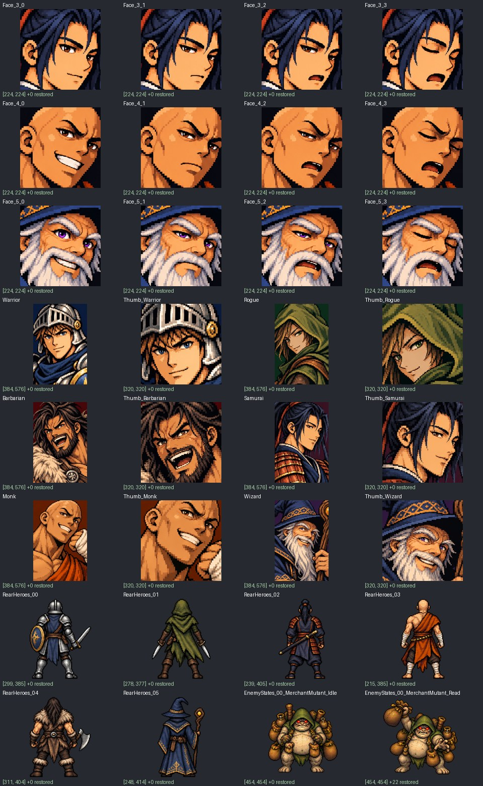
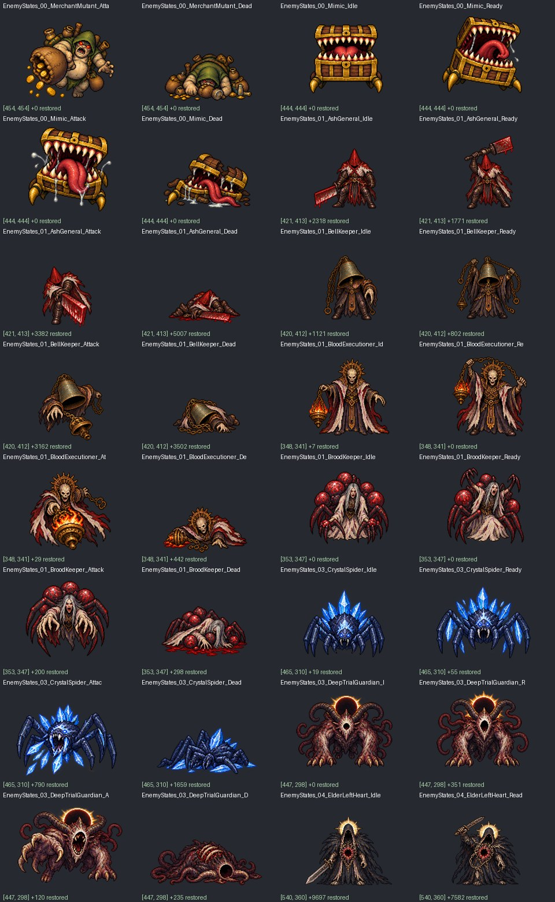
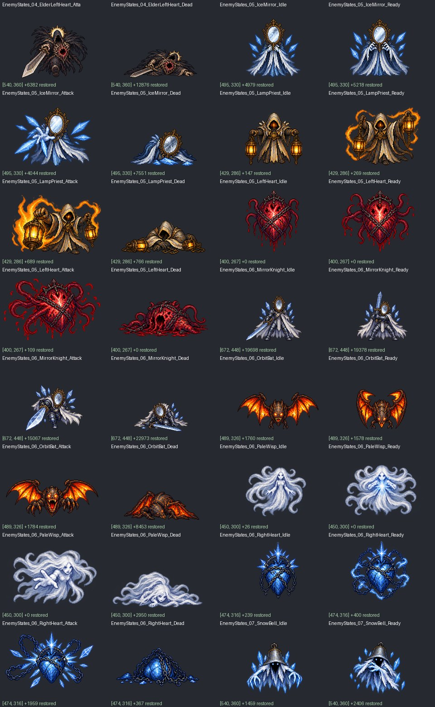
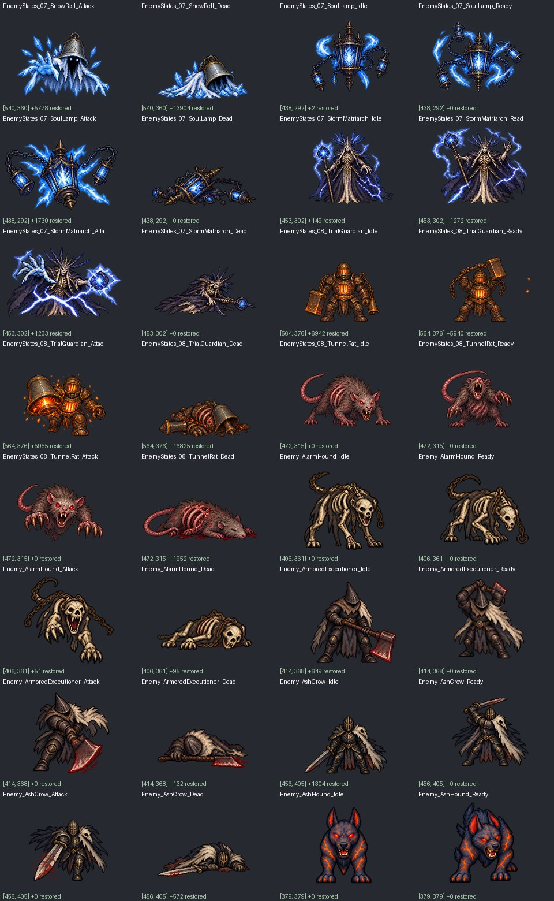
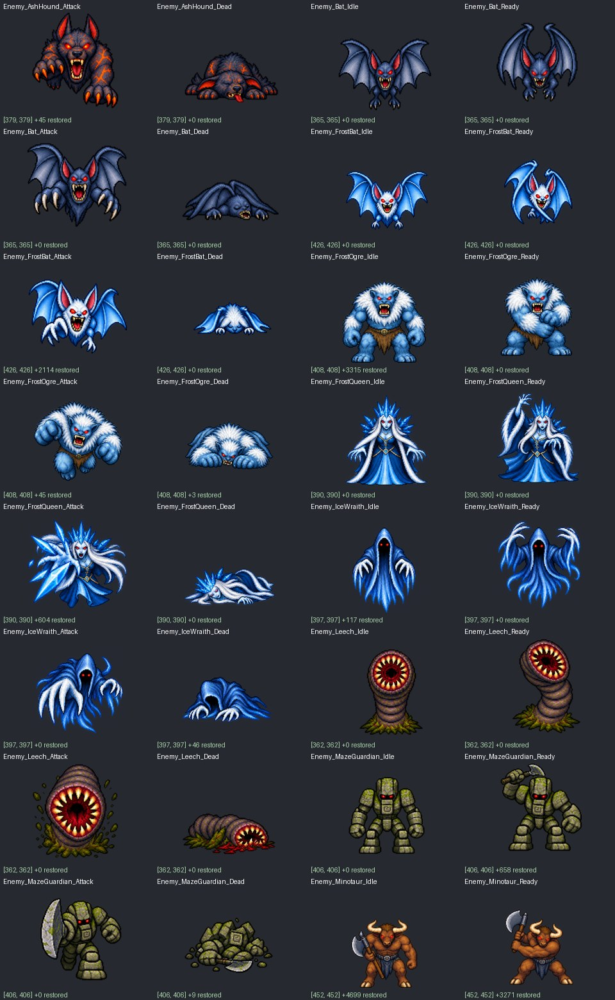
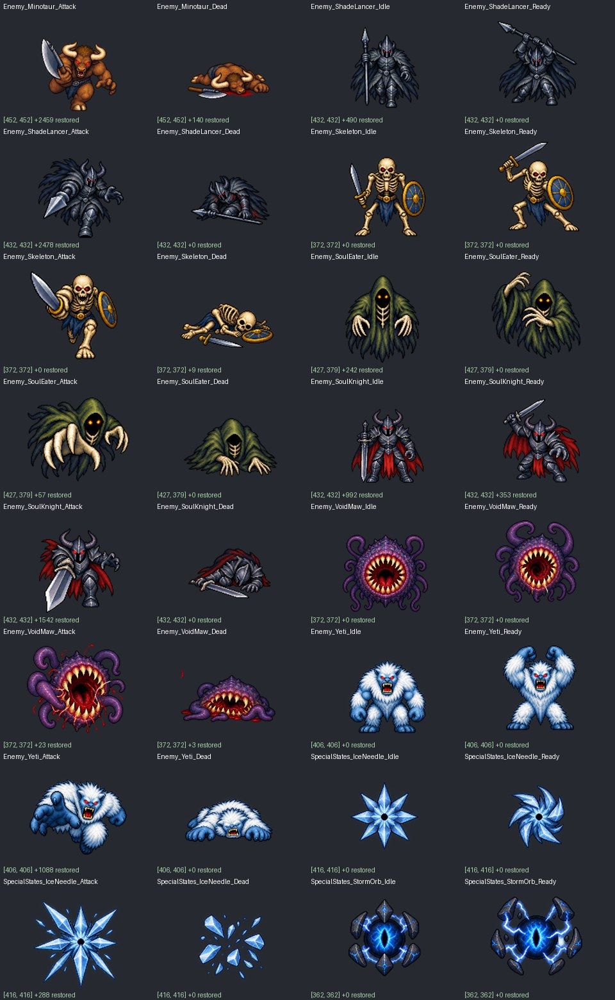
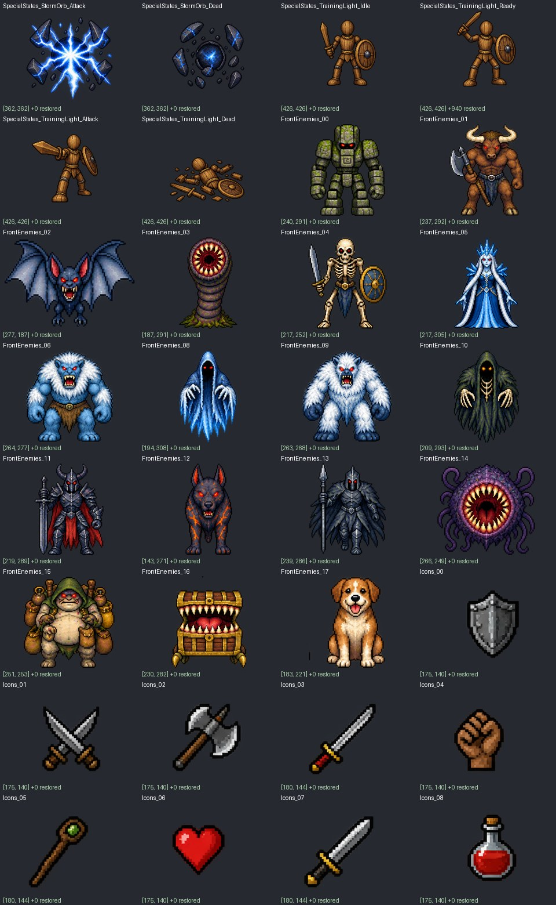
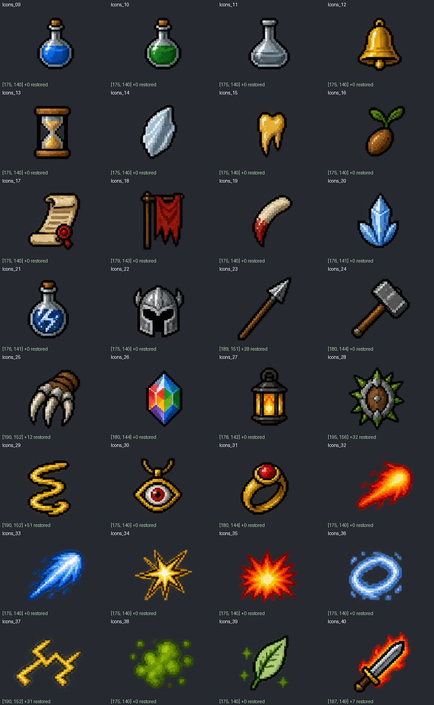
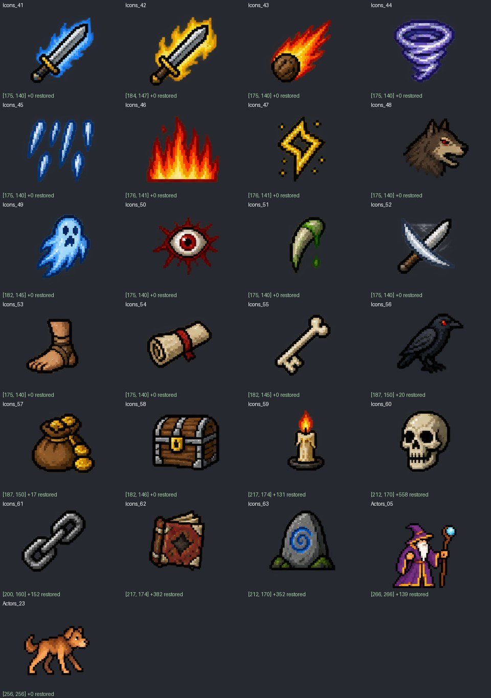
